### `ls ~/projects`

| Project | What it is |
|---|---|
| **[henami](https://github.com/henrikhhag/henami-showcase)** | One app for budget, calendar, training, food and travel. React 19 on the web, Expo on iOS, one Supabase backend. |
| **[henami-map](https://github.com/henrikhhag/henami-map)** | A map library written from scratch. Raster tiles, pan, zoom, flyTo and markers in plain JavaScript. |
| **[Pokemon-Battle](https://github.com/henrikhhag/Pokemon-Battle)** | Turn-based battles against an AI opponent, inspired by the original games. Java. |
| **[Tetris-Java](https://github.com/henrikhhag/Tetris-Java)** | Classic Tetris in Java and Swing, MVC with unit tests. |

### `git log --graph`

<picture>
  <source media="(prefers-color-scheme: dark)" srcset="https://raw.githubusercontent.com/henrikhhag/henrikhhag/output/github-snake-dark.svg" />
  
</picture>

[LinkedIn](https://www.linkedin.com/in/henrik-hagerup/) · [henami.no](https://henami.no)
